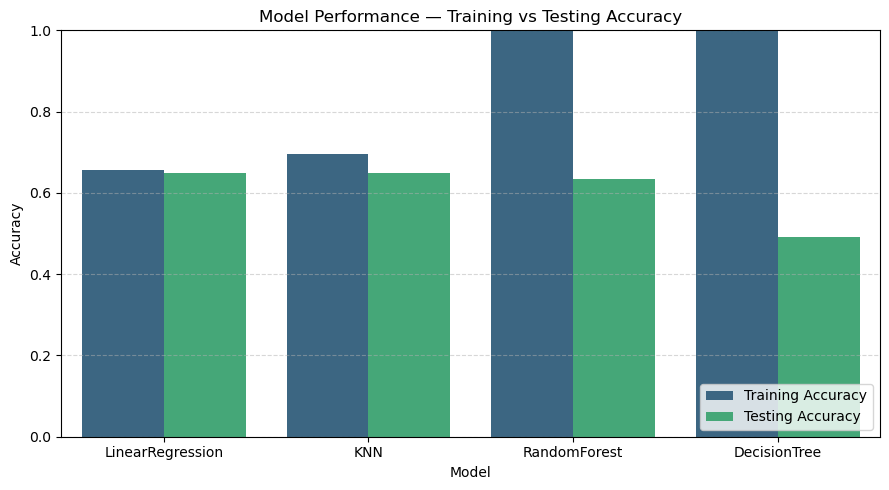

# Pet Matcher

**A student project exploring shelter-animal data and transparent preference matching.**

Pet Matcher explores how data can support people looking for a pet. The project includes a dataset used for the Bulgarian shelter-domain study, EDA, model benchmarks and a local Flask preference-matching demo.

## Project materials

- [Project notebook](notebooks/Pet_Matcher.ipynb)
- [Project proposal](docs/project_proposal.pdf)
- [Domain understanding](docs/domain_understanding.pdf)
- [Dataset](data/bulgarian_shelter_animals.csv)

The repository copy uses portable paths. Two duration charts are skipped with an explanation because the supplied CSV does not include `days_in_shelter` or adoption dates; no values were invented.

## What is implemented

The dataset contains **991 animal records and 19 columns**, covering species, breed, age, size, temperament, activity, health and adoption status, among other fields. Its source provenance and labels have not been independently verified while packaging this repository.

The notebook explores these variables and compares **Linear Regression, Decision Tree, Random Forest and KNN** on an adopted/not-adopted target. The regression baseline is thresholded for comparison. These are adoption-status benchmarks, not validated adopter–animal compatibility predictions.

The **demo uses fixed feature weights**, categorical agreement and age similarity to return seven matching animals. It does not use the trained benchmark models to choose those animals. A displayed percentage is a preference-similarity score, not a probability of a successful adoption. The prototype also does not establish that every suggested animal is currently available.



## Run locally

Use Python 3.11 or 3.12. From the repository root:

```powershell
python -m venv .venv
.venv\Scripts\python.exe -m pip install -r requirements.txt
.venv\Scripts\python.exe app/app.py
```

Open **http://127.0.0.1:5000** while the terminal is running. Enter preferences in the form and inspect the seven highest similarity scores. On macOS/Linux, use `.venv/bin/python`.

Open the notebook with:

```powershell
.venv\Scripts\python.exe -m jupyter lab notebooks/Pet_Matcher.ipynb
```

## Structure

```text
pet-matcher/
├── app/             # Flask API and preference form
├── data/            # Supplied shelter-domain dataset
├── notebooks/       # Analysis and benchmark notebook
├── reports/         # Read-only notebook report
├── docs/            # Proposal and domain research
├── requirements.txt
└── RUN_DEMO.bat
```

## Reflection

The project demonstrates data inspection, cleaning, categorical analysis, model comparisons and an explainable matching interface. Limited data and the lack of observed adopter–animal compatibility outcomes restricted the original predictive ambition.

Further work needs verified data provenance, better outcome labels, shelter feedback, filtering for available animals and evaluation with real matching decisions. Model accuracy for adoption status should not be presented as proof that a match is suitable. The system is a learning prototype and does not replace an adoption discussion with shelter staff.

The original PDFs describe planned work; the notebook and app show what was implemented. Personal feedback documents and local environments are excluded. No project-wide reuse license has been selected.
